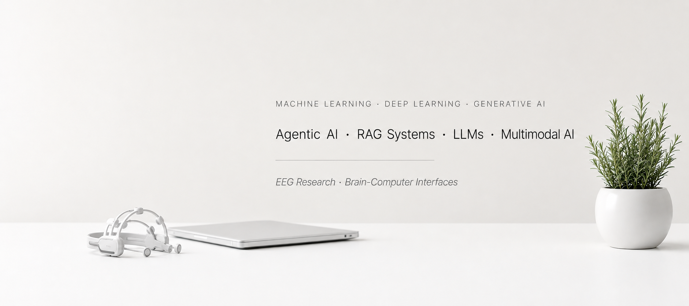

<div align="center">
  
</div>

<br/>

<div align="center">

# Himasagar Ullamgunta

**ML / AI Engineer** — I build machine learning systems end to end, from model training to production APIs.

[](https://github.com/HimasagarU)
[](mailto:himasagar.evo@gmail.com)
[](#)

</div>

<br/>

## `~/whoami`

```python
class Himasagar:
    role     = "ML/AI Engineer"
    location = "Hyderabad, Telangana, India"

    focus = [
        "Agentic AI", "RAG Systems", "LLMs",
        "Multimodal Learning", "Recommender Systems",
    ]
    domains = [
        "Machine Learning", "Deep Learning", "NLP",
        "Computer Vision", "Reinforcement Learning", "Generative AI",
    ]
    research = "EEG-based attention classification · cross-subject biomarker discovery (BCI)"

    def pipeline(self):
        return "data → features → training → inference → REST API → production"
```

<br/>

## `~/focus`

<table>
  <tr>
    <td width="50%" valign="top">
      <b>Agents &amp; LLM systems</b><br/>
      <sub>Tool-augmented ReAct agents with multi-step reasoning, self-critique passes, and streaming APIs.</sub>
    </td>
    <td width="50%" valign="top">
      <b>Retrieval &amp; RAG</b><br/>
      <sub>Hybrid search (dense + BM25), rank fusion, cross-encoder reranking, and full-text document ingestion.</sub>
    </td>
  </tr>
  <tr>
    <td width="50%" valign="top">
      <b>Recommenders &amp; multimodal</b><br/>
      <sub>Vision + text embeddings, ANN search over large catalogs, and LLM-driven generation on top.</sub>
    </td>
    <td width="50%" valign="top">
      <b>EEG &amp; BCI research</b><br/>
      <sub>Attention classification across audio, video, and text stimuli; biomarkers that generalize across subjects.</sub>
    </td>
  </tr>
  <tr>
    <td width="50%" valign="top">
      <b>Graph &amp; sequence learning</b><br/>
      <sub>GCN / GraphSAGE for classification, protein language-model embeddings for remote homology detection.</sub>
    </td>
    <td width="50%" valign="top">
      <b>Data &amp; ML pipelines</b><br/>
      <sub>SQL warehouse design, feature engineering, gradient-boosted scoring models, and BI-ready exports.</sub>
    </td>
  </tr>
</table>

<div align="center">
  <br/>
  <a href="https://github.com/HimasagarU?tab=repositories"><b>Browse my repositories →</b></a>
</div>

<br/>

## `~/stack`

<table>
  <tr>
    <td><b>Languages</b></td>
    <td>
      
      
      
      
    </td>
  </tr>
  <tr>
    <td><b>ML / DL</b></td>
    <td>
      
      
      
      
      
      
      
    </td>
  </tr>
  <tr>
    <td><b>LLMs &amp; Agents</b></td>
    <td>
      
      
      
      
      
    </td>
  </tr>
  <tr>
    <td><b>Retrieval</b></td>
    <td>
      
      
      
      
      
    </td>
  </tr>
  <tr>
    <td><b>Backend</b></td>
    <td>
      
      
      
      
    </td>
  </tr>
  <tr>
    <td><b>Frontend</b></td>
    <td>
      
      
    </td>
  </tr>
  <tr>
    <td><b>Data</b></td>
    <td>
      
      
      
      
    </td>
  </tr>
  <tr>
    <td><b>Ship</b></td>
    <td>
      
      
      
      
      
    </td>
  </tr>
</table>

<br/>

## `~/activity`

<div align="center">

[](https://github.com/HimasagarU)

</div>

<br/>

<div align="center">
  <sub>Built with curiosity. Deployed with purpose.</sub>
</div>
